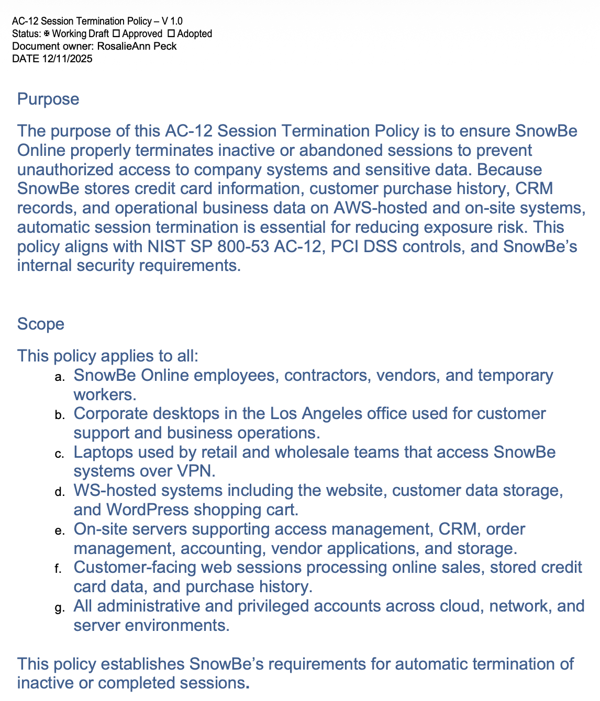
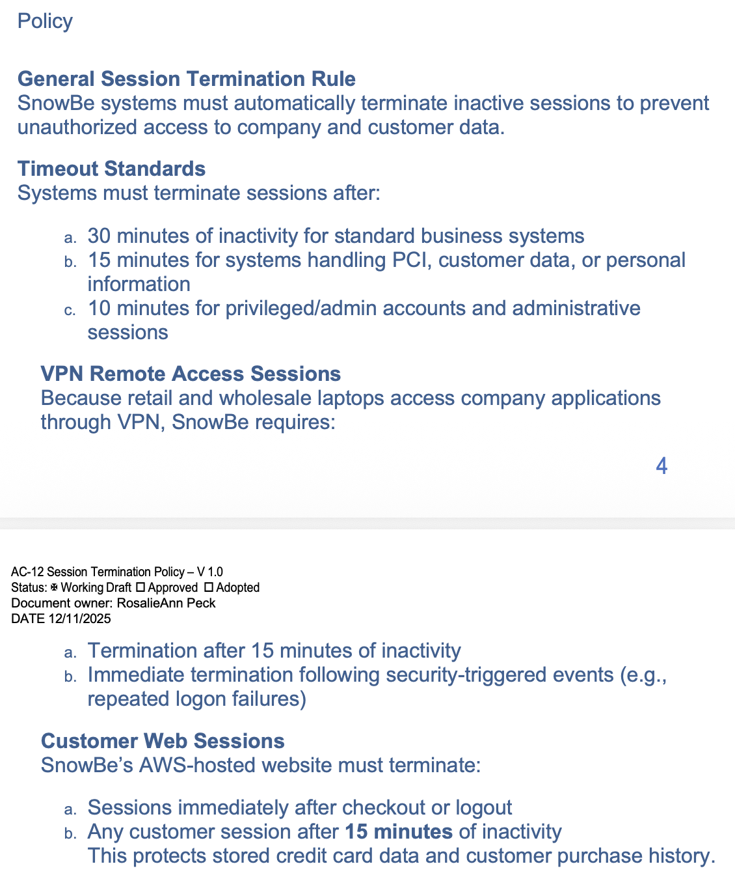
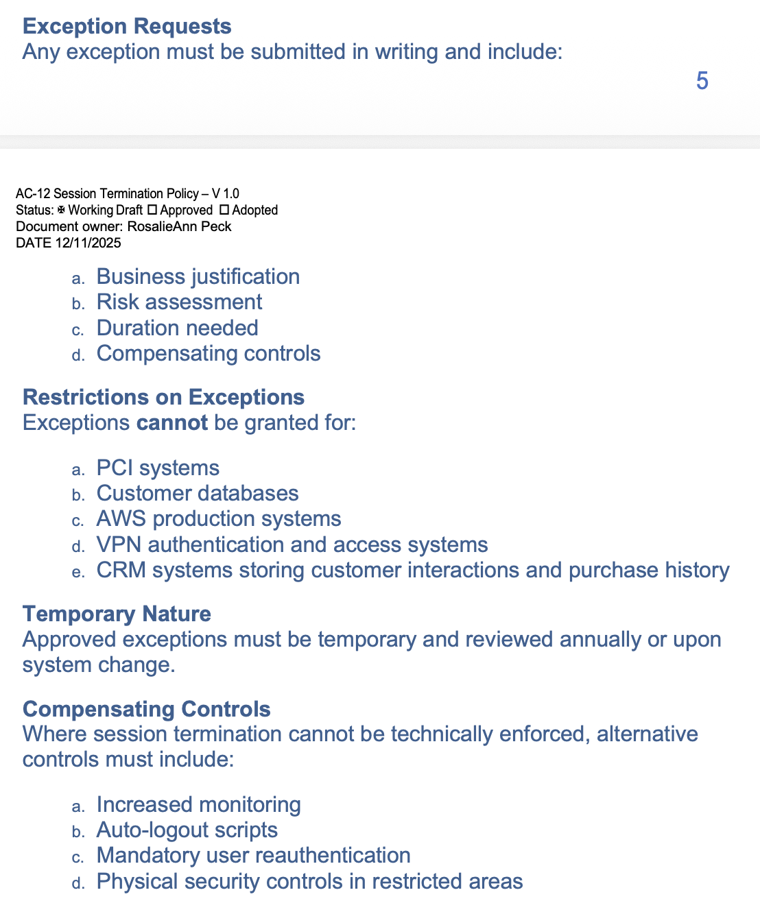
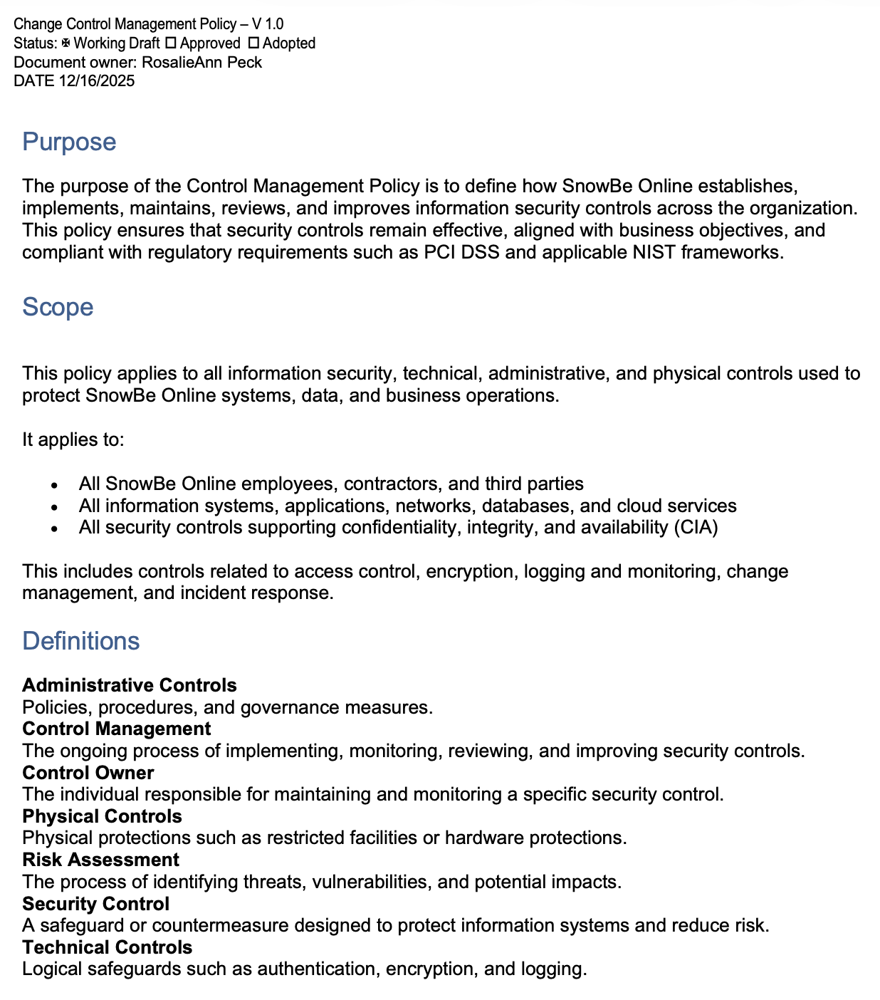
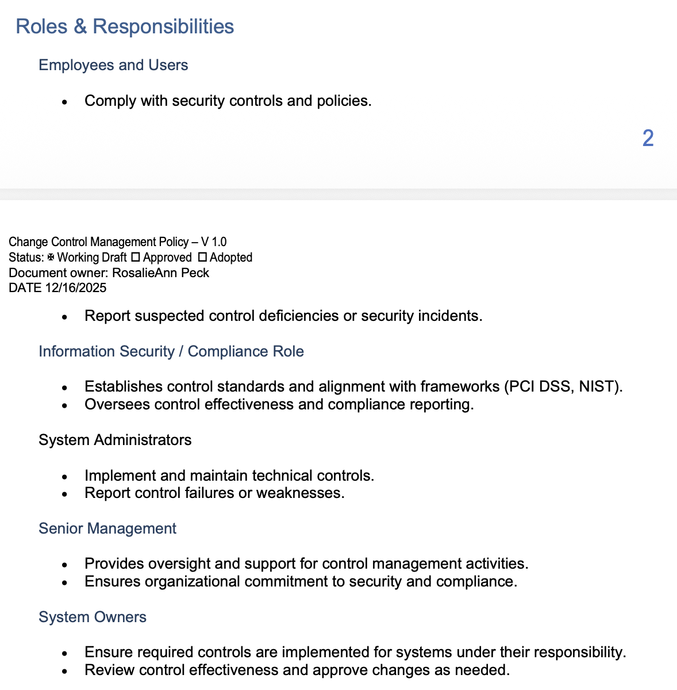
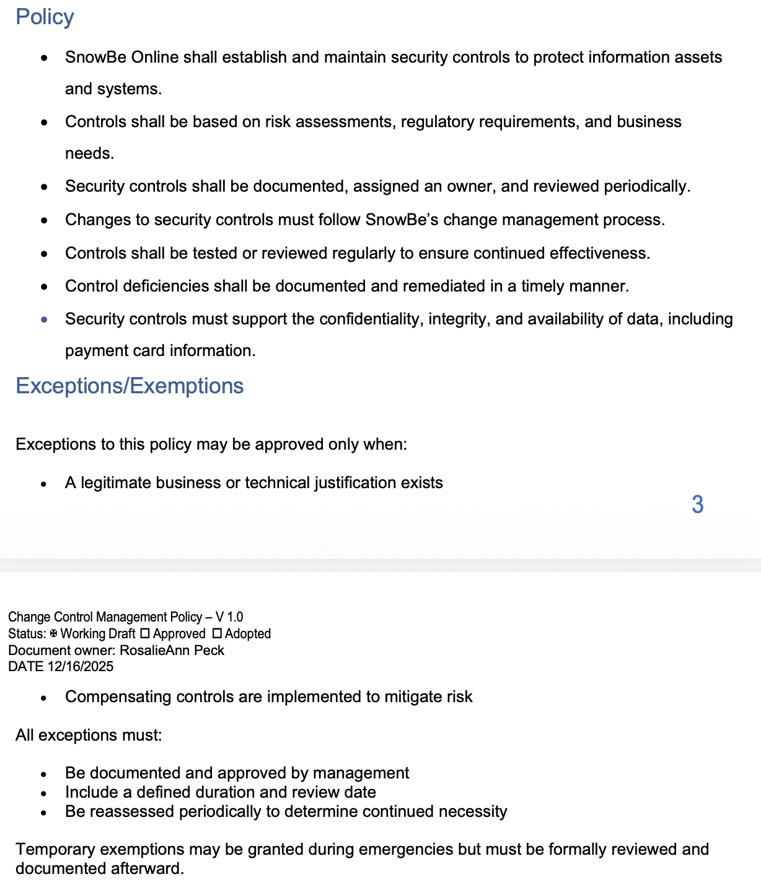
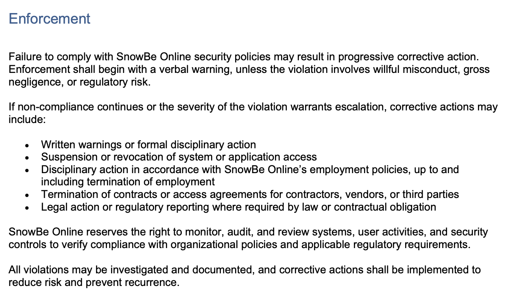

# Security Policy, Compliance & GRC

## Project Overview

This project focused on governance, risk, and compliance (GRC) through the development of formal information security policies for a simulated organization, SnowBe Online.

The project included an AC-12 Session Termination Policy and a broader Control Management Policy. Together, the policies define how security requirements are established, assigned, monitored, reviewed, enforced, and improved across cloud, network, endpoint, application, and business environments.

The work also incorporated alignment with NIST SP 800-53, PCI DSS requirements, risk assessment, control ownership, exception handling, compensating controls, and compliance enforcement.

## Objectives

- Develop formal information security policies.
- Apply NIST-aligned security controls to organizational requirements.
- Define session termination standards based on system risk.
- Establish stricter requirements for privileged and sensitive-data systems.
- Define VPN and customer-facing session requirements.
- Establish governance roles and responsibilities.
- Define procedures for policy exceptions and exemptions.
- Require compensating controls where technical enforcement is not possible.
- Define security control ownership and periodic review.
- Establish enforcement and corrective-action procedures.
- Support confidentiality, integrity, and availability of organizational data.

## Frameworks & Compliance Concepts

- NIST SP 800-53
- AC-12 Session Termination
- PCI DSS
- Governance, Risk, and Compliance (GRC)
- Risk Assessment
- Security Control Management
- Compensating Controls
- Policy Exceptions
- Least Privilege
- Privileged Account Security
- Cloud Security
- VPN Security
- Compliance Monitoring
- Audit and Enforcement

## AC-12 Session Termination Policy

The AC-12 Session Termination Policy was developed to reduce the risk of unauthorized access caused by inactive or abandoned authenticated sessions.

SnowBe Online handles customer records, purchase history, payment-card information, CRM data, and other operational information across AWS-hosted and on-site systems.

The policy therefore applies to employees, contractors, vendors, endpoints, servers, VPN-connected laptops, customer-facing systems, cloud resources, and privileged accounts.

*AC-12 Session Termination Policy purpose and scope, defining automatic session termination requirements across cloud, VPN, endpoint, server, customer-facing, and privileged-account environments.*

## Session Timeout Standards

The policy establishes different timeout requirements based on the sensitivity and risk of the system being accessed.

### Standard Business Systems

Sessions must terminate after:

`30 minutes of inactivity`

### Systems Handling Sensitive Data

Systems processing PCI information, customer data, or personal information must terminate after:

`15 minutes of inactivity`

### Privileged and Administrative Accounts

Privileged or administrative sessions must terminate after:

`10 minutes of inactivity`

These shorter timeout periods reflect the greater risk associated with elevated permissions and sensitive information.

*AC-12 session termination requirements defining timeout standards for business systems, sensitive-data environments, privileged accounts, VPN sessions, and customer web sessions.*

## VPN Remote Access

SnowBe Online uses VPN access for retail and wholesale laptops connecting to company applications.

The policy requires:

- Session termination after 15 minutes of inactivity.
- Immediate termination following certain security-triggered events.
- Termination following repeated failed authentication attempts when appropriate.

VPN sessions require additional safeguards because they provide remote access to internal organizational resources.

## Customer Web Sessions

Customer-facing systems must also enforce session termination.

Requirements include:

- Immediate session termination after checkout or logout.
- Termination after 15 minutes of inactivity.
- Protection of stored payment-card information.
- Protection of customer purchase history and other sensitive records.

These controls reduce the possibility that an abandoned browser session could be used by an unauthorized individual.

## Exception Management

A formal process was also established for requesting exceptions to session termination requirements.

Each exception request must include:

- Business justification
- Risk assessment
- Requested duration
- Compensating controls

*AC-12 exception-management requirements showing risk-based approval criteria, restricted systems, temporary exception handling, and compensating controls.*

Exceptions cannot be granted for certain high-risk systems, including:

- PCI systems
- Customer databases
- AWS production systems
- VPN authentication systems
- CRM systems containing customer interaction or purchase information

Approved exceptions must remain temporary and be reviewed periodically.

## Compensating Controls

When a technical requirement cannot be implemented exactly as written, alternative safeguards must reduce the remaining risk.

Possible compensating controls include:

- Increased monitoring
- Automatic logout scripts
- Mandatory reauthentication
- Physical security controls
- Additional access restrictions

This approach demonstrates that an exception does not mean that a security risk can simply be ignored.

## Control Management Policy

The second major portion of the project focused on managing security controls throughout their lifecycle.

The Control Management Policy defines how SnowBe Online establishes, implements, maintains, reviews, and improves security controls.

It applies to administrative, technical, and physical controls used across systems, applications, networks, databases, and cloud services.

*Control Management Policy defining scope, risk-based security controls, and administrative, technical, and physical safeguards.*

The policy recognizes several categories of safeguards:

### Administrative Controls

Policies, procedures, governance requirements, and organizational processes.

### Technical Controls

Logical safeguards including authentication, encryption, access controls, logging, and monitoring.

### Physical Controls

Controls designed to protect facilities, equipment, and physical access to systems.

## Roles & Responsibilities

Effective governance requires clearly assigned ownership.

The policy defines responsibilities for several organizational roles.

*Defined governance roles and responsibilities for employees, compliance personnel, administrators, senior management, and system owners.*

### Employees and Users

- Follow security controls and policies.
- Report suspected control deficiencies.
- Report security incidents.

### Information Security / Compliance

- Establish control standards.
- Align controls with frameworks such as PCI DSS and NIST.
- Monitor control effectiveness.
- Support compliance reporting.

### System Administrators

- Implement technical controls.
- Maintain security configurations.
- Report control failures or weaknesses.

### Senior Management

- Provide governance oversight.
- Support security and compliance activities.
- Ensure organizational commitment to control management.

### System Owners

- Ensure controls are implemented for their systems.
- Review control effectiveness.
- Approve appropriate changes.

## Security Control Requirements

The Control Management Policy establishes several core requirements.

Security controls must:

- Protect organizational systems and information assets.
- Be based on risk assessments and regulatory requirements.
- Support business requirements.
- Be formally documented.
- Have an assigned control owner.
- Be reviewed periodically.
- Follow established change-management procedures.
- Be tested for continued effectiveness.
- Have identified deficiencies documented and remediated.
- Protect confidentiality, integrity, and availability.

*Control Management Policy requirements covering risk-based controls, ownership, periodic review, change management, exception handling, and compensating controls.*

## Governance of Policy Exceptions

Exceptions to the Control Management Policy require legitimate business or technical justification.

Exceptions must:

- Be documented.
- Receive management approval.
- Include a defined duration.
- Include a review date.
- Be periodically reassessed.
- Include compensating controls where needed.

Temporary exemptions may be permitted during emergencies, but they must still be formally reviewed and documented afterward.

## Enforcement

A security policy is only effective when the organization has a process for enforcing it.

The policy establishes progressive corrective action for noncompliance.

Possible consequences include:

- Verbal or written warnings
- Formal disciplinary action
- Suspension of system access
- Revocation of application access
- Termination of employment
- Termination of third-party contracts
- Removal of vendor access
- Legal action
- Regulatory reporting

*Policy enforcement requirements defining corrective action, access revocation, auditing, investigation, and regulatory escalation for noncompliance.*

SnowBe Online also reserves the ability to monitor, audit, and review systems, user activities, and security controls to verify compliance.

Violations may be investigated and documented so corrective action can reduce the likelihood of recurrence.

## Risk Management Lessons

This project demonstrated that governance and compliance require more than writing a policy.

A complete security program also requires:

- Defined control ownership
- Risk-based requirements
- Measurable standards
- Documented exceptions
- Compensating safeguards
- Periodic review
- Technical enforcement
- Management oversight
- Audit capability
- Corrective action

The project also reinforced the importance of applying stricter controls to systems with greater business or security impact.

## Key Takeaways

- Security policies should clearly define who and what they apply to.
- Requirements should be based on risk rather than using one standard for every system.
- Privileged accounts require stronger controls.
- Sensitive systems should use shorter inactivity thresholds.
- Exceptions should be documented and temporary.
- Compensating controls are necessary when requirements cannot be implemented directly.
- Security controls should have clearly assigned owners.
- Controls must be periodically tested and reviewed.
- Governance requires participation from technical teams, management, users, and compliance personnel.
- Enforcement and auditing are important components of an effective security program.

## Skills Demonstrated

- Governance, Risk, and Compliance (GRC)
- Security policy development
- NIST SP 800-53 concepts
- AC-12 Session Termination
- PCI DSS concepts
- Risk assessment
- Security control management
- Policy exception management
- Compensating controls
- Compliance documentation
- Role and responsibility definition
- Privileged-access security
- VPN security requirements
- Cloud security governance
- Policy enforcement
- Audit and monitoring concepts
- Technical writing

## Project Evidence

This repository includes selected screenshots from the completed policy documents to demonstrate the policy-development process while keeping the public portfolio concise.

The complete coursework included additional definitions, implementation requirements, exception procedures, enforcement language, version history, and supporting references.

## Disclaimer

This project was completed as part of an authorized academic cybersecurity and compliance exercise.

SnowBe Online is a simulated case-study organization used for educational purposes. The policies shown in this repository were created to demonstrate governance, risk, compliance, and security-control development skills.